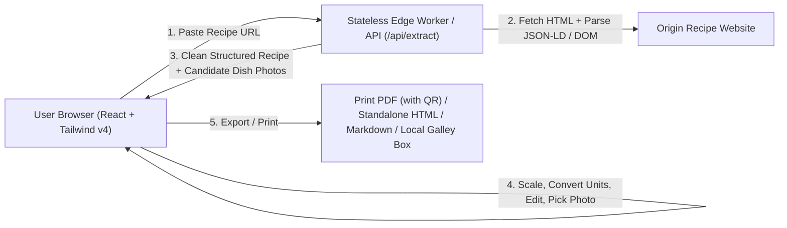

# Ten Forward (`ten-forward.the-lal.net`) — Project Specification & Living Roadmap

**Project Slug:** `ten-forward`  
**Title:** Ten Forward — Recipe Extractor & Printable Galley Card  
**Tagline:** Strip the life stories and ads from any recipe URL into a clean, printable, offline-ready galley card with full creator attribution.  
**Category:** Everyday & Kitchen Utilities  
**Target Domain:** `ten-forward.the-lal.net` (or external web app deployment)  
**Repository:** `github.com/oldcode5791/ten-forward`  
**Last Updated:** 2026-11-13  

---

## 1. Vision & Theme ("Ten Forward")
Named after the lounge and galley aboard the *USS Enterprise-D* (Deck 10, Forward Section 1) hosted by Guinan, **Ten Forward** takes cluttered, ad-heavy recipe pages and distills them into a clean, permanent, printable/saveable culinary card.

### Core Principles
1. **Creator-First Attribution:** Never strip credit. Every recipe view, print sheet, PDF, Markdown export, and standalone HTML card prominently preserves the original Chef/Author, Publication/Site Name, Publish Date, Canonical Source URL, and a scannable **QR Code** on printed copies so the user can always return to the original creator's page.
2. **Intelligent, Zero-Garbage Scraping:** Extract structured data (`schema.org/Recipe` JSON-LD & Microdata) first, with smart DOM fallback and strict image filtering so ads, avatars, social buttons, and tracking pixels are never included.
3. **Stateless Privacy-Respecting Architecture:**
   - **Edge/Server Proxy (`/api/extract` & `/api/image-proxy`):** Stateless fetch and extraction only—zero server database logging, zero user tracking.
   - **Client-Side Processing:** Scaling, unit conversion, inline editing, local Recipe Box storage (`IndexedDB` / `localStorage`), QR generation, image base64 encoding, and print/export generation run 100% in browser RAM.
4. **`the-lal.net` Design & UX Compliance:**
   - **Everyday-User First UX:** Every input, button, toggle, and slider includes a plain-English `InfoTooltip` (`?` popover) and `title` attribute.
   - **Visual System:** Dark mode workspace (`bg-slate-950` canvas, `bg-slate-900` cards, `border-slate-800` borders, `cyan-500`/`400` primary accents, `emerald-500` status badges) paired with a crisp, ink-friendly **Light Print Sheet (`@media print`)**.
   - **Zero Personal Data:** Sample recipes use Starfleet / Ten Forward culinary placeholders (e.g., *Guinan's Souris à la Crème*, *Picard's Earl Grey Shortbread*, *Riker's Alaskan Owon Omelet*).

---

## 2. System Architecture



### Stack
- **Frontend:** Vite (`^8.x`), React 19 + TypeScript (strict), Tailwind CSS v4 (`@tailwindcss/vite`).
- **Backend / Edge API:** Cloudflare Worker (`wrangler.jsonc` with static assets + `/api/*` routes) *or* portable Node/Hono server if hosted externally.
- **Zero-Server Fallback Mode:** Users can also paste raw recipe text or HTML directly into the browser if a site blocks automated requests or if working offline.

---

## 3. Intelligent Scraping & Image Filtering Pipeline

### 3.1 Recipe Data Extraction Priority
1. **Tier 1 — JSON-LD (`application/ld+json`):**
   - Scan all `<script type="application/ld+json">` blocks (supporting nested `@graph` arrays and `["Recipe"]` type arrays).
   - Extract: `name`, `description`, `author`, `publisher`, `datePublished`, `prepTime`, `cookTime`, `totalTime` (ISO 8601 duration parser), `recipeYield`, `recipeCategory`, `recipeCuisine`, `keywords`, `recipeIngredient`, `recipeInstructions` (`HowToStep` and `HowToSection`), `nutrition`, and `aggregateRating`.
2. **Tier 2 — Microdata / RDFa Fallback:**
   - Query `itemtype*="schema.org/Recipe"` attributes (`itemprop="recipeIngredient"`, `itemprop="recipeInstructions"`, etc.).
3. **Tier 3 — Readability + Heuristic Recipe Block Parser:**
   - Locate common recipe card containers (`.wprm-recipe-container`, `.tasty-recipes`, `.mv-create-card`, `.easyrecipe`, `article`) and parse ingredient lines (quantity + unit + ingredient) and numbered steps.
4. **Tier 4 — Raw Text Paste Parser (100% Client-Side):**
   - Smart text splitter that detects `Ingredients:`, `Instructions:`/`Directions:`, `Notes:`, and metadata from pasted clipboard text.

### 3.2 Intelligent Image Extraction (Anti-Garbage Filter)
To ensure we only capture photos of the actual dish and cooking steps:
1. **Primary Source (Structured Recipe Images):**
   - Pull `recipe.image` from JSON-LD (string, object with `url`, or array of candidate URLs).
   - Pull per-step images from `HowToStep.image` when available.
   - Deduplicate WordPress/CDN size variants (e.g., `pasta-720x720.jpg`, `pasta-720x540.jpg`, `pasta-1200x800.jpg` -> keep the highest resolution original).
2. **Secondary Source (Meta Tags):**
   - `<meta property="og:image">`, `<meta name="twitter:image">`.
3. **Tertiary Source (Filtered Article DOM Images):**
   - Unwrap lazy attributes (`data-src`, `data-lazy-src`, `data-pin-media`, `srcset` highest-width entry).
   - **Hard Reject Filter:** Discard any image where `src`, `alt`, `class`, or parent container matches:
     - `avatar`, `author`, `bio`, `gravatar`, `profile`
     - `logo`, `icon`, `favicon`, `badge`, `seal`, `award`
     - `ad-`, `ads`, `banner`, `sponsor`, `affiliate`, `amazon`
     - `share`, `pinterest`, `facebook`, `instagram`, `twitter`, `social`, `print-button`
     - `pixel`, `tracker`, `1x1`, `spacer`, `emoji`, `wp-smiley`
     - File extensions `.svg` or `.gif`
   - **Dimension & Aspect Ratio Filter:** Reject images with explicit `width < 240` or `height < 180`, or extreme banner ratios (`width / height > 3.2` or `< 0.3`).
4. **User Photo Selector & Offline Embedding:**
   - Present top candidate dish photos in a **Photo Picker Strip** so the user can choose their favorite cover image, toggle step photos on/off, or select **"No Photo (Text Only)"**.
   - Convert the chosen cover photo to an optimized Data URL (`webp`/`jpeg`) via `/api/image-proxy` + `<canvas>` so exported `.html` and `.md` files work 100% offline.

---

## 4. Attribution Specification (Mandatory on All Views & Exports)

Every extracted or manually entered recipe carries a dedicated `AttributionRecord`:

```ts
export interface AttributionRecord {
  sourceUrl: string;          // Canonical URL (stripped of tracking query params like utm_*)
  domain: string;             // e.g., "seriouseats.com"
  siteName: string;           // e.g., "Serious Eats"
  authorName: string;         // e.g., "J. Kenji López-Alt"
  authorUrl?: string;         // Optional link to author profile
  publishedDate?: string;     // ISO date or readable string
  extractedAt: string;        // Date saved in Ten Forward
  licenseOrNote?: string;     // e.g., "Personal kitchen copy — original copyright belongs to creator"
}
```

### How Attribution Appears:
- **In-App Header Card:** Displays a dedicated **Creator Attribution Banner** directly below the recipe title:
  - Author Name + Site Name badge
  - Clickable canonical URL (opens original recipe in a new tab)
  - Editable attribution popover (in case the user wants to credit *"Grandma Rose's Recipe Box"* or tweak a blog author name)
- **Print & PDF Output (`@media print`):**
  - Top attribution subtitle: `Recipe by [Author] • Published on [Site Name]`
  - Bottom footer: Full canonical URL + extraction date
  - **Corner QR Code (SVG):** Crisp client-generated SVG QR code linking directly to `sourceUrl` with caption `"Scan for original recipe on [domain]"`.
- **Standalone HTML & Markdown Exports:**
  - Markdown includes YAML frontmatter (`source_url`, `author`, `site`, `date_saved`) + a visible blockquote attribution header.
  - Standalone HTML includes a permanent source header link and embedded QR code.

---

## 5. Interactive Features & UX Checklist

| Feature | Description | `InfoTooltip` Required |
| :--- | :--- | :---: |
| **URL Extractor Bar** | Input URL + "Extract Recipe" button + URL query param support (`?url=...`) | Yes |
| **Paste Text / Manual Fallback** | Paste raw recipe text or HTML when offline or copying from emails/books | Yes |
| **Starfleet Sample Preset** | Load sample Ten Forward recipes to test scaling, printing, and exports immediately | Yes |
| **Portion Scaler** | Quick buttons (`0.5x`, `1x`, `2x`, `3x`) + custom serving count adjuster that scales fractions (`1/2`, `¾`, `1 1/3`) accurately | Yes |
| **Unit Converter** | Toggle between Original, Metric (`g`, `kg`, `ml`, `L`, `°C`), and US Imperial (`oz`, `lb`, `cups`, `°F`) | Yes |
| **Photo Controls** | Pick hero image from scraped candidates, toggle step images, or switch to Ink-Saver (No Photos) | Yes |
| **Inline Recipe Editor** | Edit title, times, ingredients, steps, chef notes, or attribution before printing/saving | Yes |
| **Cook Mode (Galley Display)** | Checkable ingredients, clickable active step highlight, and Screen Wake Lock (`navigator.wakeLock`) | Yes |
| **Print Layout Configurator** | Choose 1-Page Compact vs. Standard layout, font size, QR code toggle, and photo toggle | Yes |
| **Save & Export Suite** | Print / PDF, Standalone Offline `.html`, Obsidian/Notion `.md`, `.json`, and Local Browser Recipe Box (`localStorage`) | Yes |

---

## 6. Implementation Phases & Status Tracker

- [x] **Phase 0: Project Folder & Living Specification**
  - Created `/home/vivian/projects/ten-forward/PROJECT_SPEC.md`
- [x] **Phase 1: Project Scaffold & Cloudflare Worker Setup**
  - Scaffolded Vite + React 19 + TypeScript + Tailwind CSS v4 + Worker entry (`worker/index.ts`) for `/api/extract` and `/api/image-proxy` + Vite dev-server middleware in `vite.config.ts`
  - Configured `public/favicon.svg` (`?v=2`), SEO meta tags in `index.html`, and `src/components/InfoTooltip.tsx`
- [x] **Phase 2: Core Scraper, JSON-LD Parser & Anti-Garbage Image Filter**
  - Built `src/utils/recipeScraper.ts`: `schema.org/Recipe` parser (`@graph`, arrays, ISO durations, HTML entity decoding)
  - Built 3-layer anti-garbage image filter & resolution deduplicator
  - Built client-side raw text/HTML parser fallback (`parseRawRecipeText`)
- [x] **Phase 3: Scaling, Unit Conversion & Attribution Engine**
  - Built `src/utils/ingredientScaler.ts`: fraction parser & formatter (`1/4`, `1/3`, `1/2`, `2/3`, `3/4`, mixed numbers) + Metric/Imperial converter & oven temperature converter
  - Built `src/utils/qrSvg.ts` & `src/components/QrCodeBox.tsx`: zero-dependency client-side SVG QR Code generator for print and HTML attribution
- [x] **Phase 4: Ten Forward UI, Print Stylesheet & Local Galley Box**
  - Built `src/App.tsx`: Dark-slate workspace UI (`bg-slate-950` / `bg-slate-900` / `cyan-500`) with 3 Starfleet TNG presets in `src/data/starfleetRecipes.ts`
  - Added dedicated `@media print` ink-friendly stylesheet (`src/index.css`) with QR + Creator Attribution banner
  - Built `src/utils/exportCompilers.ts` for standalone offline `.html` cards and `.md` files with YAML attribution frontmatter + Local Galley Box (`localStorage`)
- [x] **Phase 5: Verification & Polish**
  - Verified scraper, high-res image deduplication, garbage image rejection, `oxlint` (0 warnings/0 errors), and production `tsc -b && vite build`.
